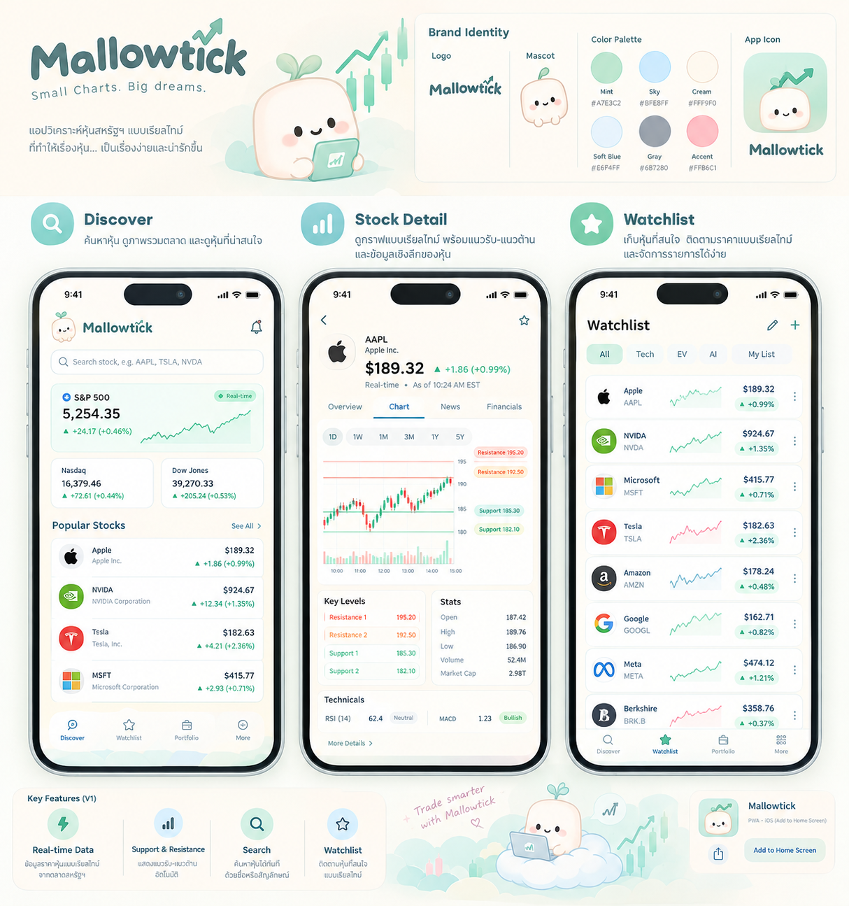

# Mallowtick

*Small charts. Big dreams.* A friendly US stock analysis PWA for iPhone Safari with real market data, candlestick charts, calculated support/resistance levels, and a watchlist.



- **Discover:** search US stocks by ticker or name, see ETF benchmarks (SPY/QQQ/DIA by default), configured popular stocks, and the market status.
- **Stock Detail:** latest price with freshness, an interactive candlestick chart (1D–5Y) with volume, support/resistance lines, Key Levels with the method explained, and session stats.
- **Watchlist:** saved symbols with prices, changes and intraday sparklines, stored on the device.
- **Installable PWA:** manifest, icons, safe areas, and an offline shell. Market data is never cached as live.

No sample or mock prices exist anywhere in the app. Without a provider key, it says so.

## Repository layout

```text
apps/web          Next.js 16 (App Router, TypeScript strict, Tailwind 4, TanStack Query, Lightweight Charts)
services/api      Go 1.27 + Gin API: Twelve Data adapter, caching, support/resistance
docs/             architecture.md · api.md · market-data.md · support-resistance.md · design-reference.png
```

## Requirements

Node ≥ 22 with pnpm 12 (see `packageManager`), Go 1.27, and optionally `golangci-lint` v2 for `make lint`.

## Setup

```bash
make install                                   # pnpm install + go mod download
cp services/api/.env.example services/api/.env # then set TWELVEDATA_API_KEY
cp apps/web/.env.example apps/web/.env.local   # defaults point at http://localhost:8080
```

**Market data provider.** Create a key at <https://twelvedata.com> and set `TWELVEDATA_API_KEY` in `services/api/.env`. Set `TWELVEDATA_CREDITS_PER_MINUTE` to your plan's allowance (free plan: 8). Set `MARKET_DATA_LATENCY` to what your plan actually provides; it's shown to users verbatim. Without a key, the API still starts, and the app shows **"Data provider not configured"**. Read [docs/market-data.md](docs/market-data.md) for plan limits, licensing, and credit budgeting.

## Run locally

```bash
make dev-api   # http://localhost:8080  (loads services/api/.env)
make dev-web   # http://localhost:3000  (proxies /api/v1 to API_ORIGIN)
```

To try it on an iPhone, the PWA needs HTTPS. For local testing, expose the web port through an HTTPS tunnel, open it in Safari, then use Share → Add to Home Screen. The service worker only registers in production builds (`pnpm --filter @mallowtick/web build && pnpm --filter @mallowtick/web start`).

## Checks

| Command | What it runs |
|---|---|
| `make test` | `go test -race ./...` and Vitest (unit + component tests) |
| `make lint` | `go vet`, `golangci-lint`, ESLint, `tsc --noEmit`, Prettier check |
| `make build` | `go build` → `services/api/bin/api`, `next build` |
| `make icons` | Regenerate PWA icons from SVG |

## Configuration

API (`services/api/.env`): see the commented [`.env.example`](services/api/.env.example). Key variables: `TWELVEDATA_API_KEY`, `TWELVEDATA_CREDITS_PER_MINUTE`, `MARKET_DATA_LATENCY`, `QUOTE_CACHE_TTL`, `MARKET_OVERVIEW_SYMBOLS`, `POPULAR_SYMBOLS`, `API_CORS_ORIGINS`.

Web (`apps/web/.env.local`): `API_ORIGIN` (server-only, read at runtime by the proxy) and `NEXT_PUBLIC_QUOTE_REFRESH_SECONDS`.

The provider key exists only on the API server. The browser talks to the Next.js origin, which proxies to the API.

## Known limitations

See [docs/architecture.md](docs/architecture.md#known-limitations). In short: quotes are polled rather than streamed, benchmarks are ETFs rather than index levels, the watchlist is per device, there are no logos/news/fundamentals, and the free provider plan's daily credits are tight.

*For information only — not investment advice. Market data by Twelve Data. Charts by TradingView Lightweight Charts™.*
